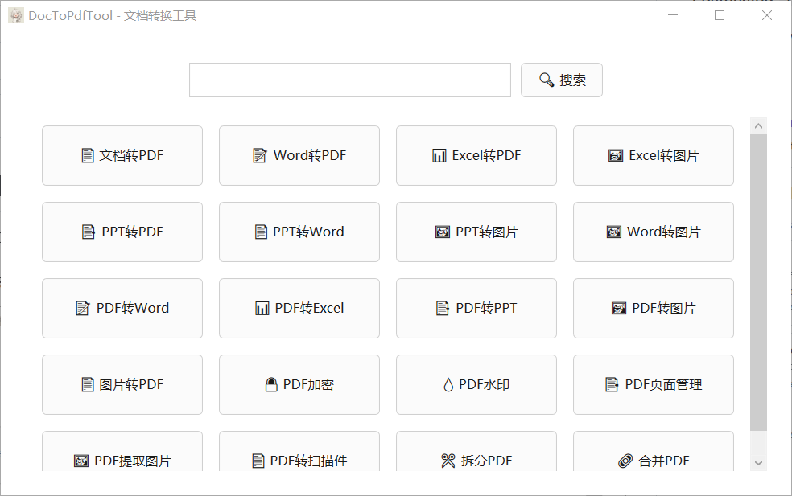

# DocToPdfTool

多功能文档格式转换工具，支持 **文档转 PDF**、**Word 转 PDF**、**Excel 转 PDF**、**Excel 转图片**、**PPT 转 PDF**、**PPT 转 Word**、**PPT 转图片**、**Word 转图片**、**图片转 PDF**、**PDF 加密/解密**、**PDF 水印**、**PDF 页面管理**、**PDF 提取图片**、**PDF 压缩**、**PDF 转 Word**、**PDF 转 Excel**、**PDF 转 PPT**、**PDF 转图片**、**PDF 转扫描件**、**拆分 PDF** 和 **合并 PDF** 等 21 项功能。



## 界面

- **首页**：程序启动后展示功能主页，顶部为搜索框（输入关键词即可模糊匹配功能），下方为所有功能按钮网格（水平居中，功能增多时可滚动）
- **功能页**：点击首页功能按钮或搜索结果后，在同一窗口内切换到「左侧导航 + 右侧功能区」布局，并自动定位左侧菜单选中项（自动滚动到可视区）
- **返回首页**：功能页左上角提供「🏠 首页」按钮，可随时返回主页
- **单窗口路由**：首页与功能页之间为同一窗口内的页面切换，不会打开新窗口

## 功能

### 文档转 PDF
- **双引擎转换**：支持 WPS Office 和 Microsoft Office 两种转换引擎，运行时自由切换
- **格式支持**：Word（.doc/.docx）、Excel（.xls/.xlsx）、PPT（.ppt/.pptx）、文本（.txt/.rtf）、HTML（.html/.htm/.mhtml）
- **HTML 转换**：基于 Edge 浏览器 headless 模式，保留原始布局和样式
- **Excel 多工作表**：不做额外页面设置改动，输出与 WPS / Office 自身「导出为 PDF」的默认打印效果一致，完整转换所有工作表
- **批量转换**：支持添加/拖拽多个文档，逐文件显示转换进度
- **拖拽添加**：支持拖拽文档到列表，列表中间显示操作提示

### Word 转 PDF
- **内置引擎，无需外部依赖**：基于 Spire.Doc 本地 DLL，无需安装 Microsoft Office 或 WPS
- **批量转换**：支持同时添加多个 Word 文件，逐个转换
- **拖拽添加**：支持拖拽 Word 文件到列表

### Excel 转 PDF
- **内置引擎，无需外部依赖**：基于 Spire.XLS 本地 DLL，无需安装 Microsoft Office 或 WPS
- **格式支持**：Excel（.xls/.xlsx）
- **三档页面缩放**：
  - `按宽度适应`（默认）— 所有列压缩到一页宽，行继续纵向分页，**列不会被横向切断**
  - `整表缩放到单页` — 每张工作表输出为一页，小表一页看完
  - `实际大小` — 完全按原表列宽分页，超宽时横向分页（还原 Excel 原生打印效果）
- **输出整洁**：转换结果不含附加标注页与提示文字（引擎自动生成的提示工作表会自动剔除）
- **内存优化**：转换前跳过公式重算、转换后自动清理引擎缓存，降低批量转换时的内存峰值
- **批量转换**：支持同时添加多个 Excel 文件，逐个转换
- **拖拽添加**：支持拖拽 Excel 文件到列表

### Excel 转图片
- **内置引擎，无需外部依赖**：本地 DLL 渲染，无需安装 Microsoft Office 或 WPS
- **每表一图**：每张有内容的工作表输出为一张完整图片，命名 `工作簿名_工作表名.png`
- **内容不截断**：整表按内容缩放到单页再渲染，一张表的内容完整呈现在一张图内，不会被分页切开
- **自动裁边**：图片尺寸贴合表格实际内容，不含 A4 纸张的多余空白边距
- **输出整洁**：转换结果不含附加标注文字与提示页
- **尺寸保护**：超大表（如数千行）超出位图上限时自动下调 DPI（下限 24），保证单图完整输出不崩溃
- **可调参数**：支持 DPI（96/150/300，默认 150）、输出格式（JPG/PNG，默认 PNG 无损）
- **临时文件自动清理**：逐表中转 PDF 与分页图片在转换结束后删除（带句柄重试）
- **批量转换**：支持同时添加多个 Excel 文件，逐个转换
- **拖拽添加**：支持拖拽 Excel 文件到列表

### PPT 转 PDF
- **内置引擎，无需外部依赖**：基于 Spire.Presentation 本地 DLL，无需安装 Microsoft Office 或 WPS
- **格式支持**：PowerPoint（.ppt/.pptx）
- **长文档完整转换**：本地 DLL 引擎支持大页数文档完整输出，内容不截断
- **内存优化**：每次转换后强制 GC + 归还内存给操作系统，降低批量转换时的内存峰值
- **批量转换**：支持同时添加多个 PPT 文件，逐个转换
- **拖拽添加**：支持拖拽 PPT 文件到列表

### PPT 转 Word
- **内置引擎，无需外部依赖**：基于本地 DLL（Spire.Presentation + Spire.PDF），无需安装 Microsoft Office 或 WPS
- **格式支持**：PowerPoint（.ppt/.pptx）→ Word（.docx）
- **两段式转换**：先由 Spire.Presentation 将 PPT 渲染为中间 PDF，再由 Spire.PDF 转换为 DOCX，临时文件自动清理
- **完整输出**：中间 PDF 由本地 DLL 生成，最终 DOCX 完整保留全部页面
- **内存优化**：每次转换后强制 GC + 归还内存给操作系统
- **批量转换**：支持同时添加多个 PPT 文件，逐个转换
- **拖拽添加**：支持拖拽 PPT 文件到列表

### PPT 转图片
- **内置引擎，无需外部依赖**：基于 Spire.Presentation 本地 DLL，无需安装 Microsoft Office 或 WPS
- **逐页导出**：每张幻灯片输出为独立图片，命名 `原文件名_1.png`、`原文件名_2.png` …
- **长文档完整转换**：本地 DLL 引擎支持大页数文档完整输出，内容不截断
- **高质量渲染**：开启 `HighQualityImage` 高质量渲染，JPG 使用 100% 质量编码
- **可调参数**：支持 DPI（96/150/300）、输出格式（JPG/PNG，默认 PNG 无损）
- **内存优化**：每页完成即触发回调回收，转换结束强制 GC + 归还内存
- **批量转换**：支持同时添加多个 PPT 文件，逐个转换
- **拖拽添加**：支持拖拽 PPT 文件到列表

### Word 转图片
- **内置引擎，无需外部依赖**：基于 Spire.Doc 本地 DLL，无需安装 Microsoft Office 或 WPS
- **矢量重渲染**：通过 `SaveToImages(ImageType.Metafile)` 取得矢量 EMF，再按目标 DPI 绘制，文字/表格完整且任意 DPI 下均清晰
- **长文档完整转换**：本地 DLL 引擎支持大页数文档完整输出，内容不截断
- **可调参数**：支持 DPI（96/150/300）、输出格式（JPG/PNG，默认 PNG 无损）
- **无 Office 副作用**：不启动 Word 进程，无窗口弹出，单文件耗时远低于 COM 方案
- **批量转换**：支持同时添加多个 Word 文件，逐个转换
- **拖拽添加**：支持拖拽 Word 文件到列表

### PDF 转 Word
- **双引擎转换**：支持 Microsoft Office 和内置引擎（Spire.PDF）两种转换引擎，运行时自由切换
- **内置引擎无需 Office**：基于本地 PDF 引擎，无需安装 Microsoft Office，长文档完整转换
- **大文件分批处理**：超过 20 页的 PDF 自动分批转换后合并，内存峰值可控
- **Microsoft Office 引擎**：基于 Word COM 自动化，质量高但需要安装 Office
- **批量转换**：支持同时添加多个 PDF 文件，逐个转换
- **拖拽添加**：支持拖拽 PDF 文件到列表

### PDF 转图片
- **Windows 内置引擎**：基于 Windows 10/11 内置 PDF 渲染引擎（`Windows.Data.Pdf`），无需额外安装软件
- **批量转换**：支持同时添加多个 PDF 文件，每页生成一张图片
- **拖拽添加**：支持拖拽 PDF 文件到列表
- **可调参数**：支持 DPI（72/96/150，默认 150）、缩放倍率（1×~5×，默认 1×）、输出格式（JPG/PNG）
- **像素上限保护**：单页超过 2.5 亿像素时自动等比缩小，避免 GDI+ 位图内存溢出
- **零依赖**：不依赖 pdfium.dll、Ghostscript 或 Office 组件

### 图片转 PDF
- **零依赖**：纯 .NET 直接写入 PDF 1.4（`BinaryWriter` + DCTDecode），不依赖任何 PDF 库或 Office 组件
- **两种输出方式**：
  - `合成一个 PDF`（默认）— 所有图片按列表顺序合成一个 PDF，一张图一页
  - `每张图各出一个 PDF` — 每张图片单独生成一个 PDF，命名 `文件名_001.pdf`、`文件名_002.pdf` …
- **JPEG 无损嵌入**：普通 JPEG 原图以 DCTDecode 直接嵌入，不重编码，画质零损失、速度更快
- **格式转换**：PNG / BMP / GIF / TIFF 自动铺白底后转 JPEG 嵌入（PDF 不支持透明通道）
- **EXIF 方向纠正**：自动读取手机竖拍照片的方向标记并旋转到正确朝向
- **三档页面尺寸**：
  - `A4 适应`（默认）— 等比缩放放进 A4，按图片横竖自动选择纸张方向，四周留白
  - `A4 铺满` — 等比放大填满 A4，超出部分居中裁切
  - `原始尺寸` — 按图片自身 DPI 换算物理尺寸
- **边距可选**：0 / 5 / 10 / 20 mm（默认 10 mm）
- **顺序调整**：列表顺序即页序，支持上移 / 下移 / 移除，也支持拖拽一次追加多张
- **缩略图预览**：列表显示缩略图与原始像素尺寸，便于核对顺序
- **大图保护**：长边超过 5000 px 自动降采样，避免解码内存峰值过高
- **容错**：单张图片损坏或格式不支持时跳过并提示，不中断整个任务
- **重名保护**：输出文件重名时自动追加序号

### PDF 加密
- **内置引擎，无需外部依赖**：基于本地 PDF 引擎，无需安装 Microsoft Office 或 WPS
- **两种模式**：`加密`（给 PDF 加打开密码）/ `移除密码`（解除已有密码）
- **加密算法**：AES-256（推荐）/ AES-128 / RC4-128（兼容旧版阅读器）
- **打开密码**：必填，需二次确认，防止输入错误导致文件打不开
- **编辑密码可选**：留空则只设置打开密码、不限制编辑与权限；填写后可按预设限制权限
- **权限预设**：`仅查看`（默认）/ `允许打印` / `全部允许` / `自定义`（打印、复制、修改、批注、填表逐项勾选）
  - 选择 `仅查看` 等受限权限时，用打开密码进入后尝试编辑/打印，阅读器（Adobe / WPS / 福昕等）会要求输入编辑密码
  - 若权限为 `全部允许`，编辑与打印不受限制，阅读器不会索要编辑密码
- **移除密码**：需提供编辑密码；若原文件未设置编辑密码，填打开密码或留空即可
- **输出保护**：输出为 `原文件名_已加密.pdf` / `原文件名_已解密.pdf`，不覆盖原文件，重名自动追加序号
- **批量处理**：支持多个文件，单个失败不影响其余，结束后汇总失败清单
- **状态识别**：列表自动标注每个文件「已加密 / 未加密」并显示页数

### PDF 水印
- **内置引擎，无需外部依赖**：基于本地 PDF 引擎在页面内容之上绘制，不依赖 Office 或第三方工具
- **两种类型**：
  - `文字`：自定义内容、字号（8~300）、颜色（灰/红/蓝/黑）
  - `图片`：支持 PNG/JPG/BMP，按页宽比例缩放（默认 30%），建议用透明背景 PNG
- **半透明与旋转**：透明度 10%~70%，角度 0°/30°/45°/90°，默认 45° 斜向
- **平铺模式**：可铺满整页，也可单个居中
- **页码范围**：留空=全部页，支持 `1-3,5` 写法
- **水印不破坏原文字层**：绘制在原内容之上，原文字仍可选中与搜索
- **加密文件识别**：自动检测并提示先用「PDF 加密 → 移除密码」解除
- **输出保护**：输出为 `原文件名_已加水印.pdf`，不覆盖原文件，重名自动追加序号
- **批量处理**：单个失败不影响其余，结束后汇总

### PDF 页面管理
- **缩略图预览**：打开 PDF 后自动渲染每页缩略图，所见即所得
- **旋转**：左转 / 右转 90°，实时显示当前角度，可批量对多个选中页旋转
- **删除**：移除不需要的页面；不允许删光，至少保留一页
- **调整顺序**：上移 / 下移，支持多选连续移动
- **仅导出选中页**：把选中的页按当前顺序导出为新 PDF
- **导出全部页**：按当前顺序与旋转导出完整 PDF
- **重置**：一键回到原始文件状态，撤销所有改动
- **加密文件识别**：自动检测并提示先用「PDF 加密 → 移除密码」解除
- **输出保护**：`原文件名_页面管理.pdf` / `原文件名_选中页.pdf`，不覆盖原文件，重名自动追加序号

### PDF 提取图片
- **从 PDF 中导出所有内嵌图片**，每个 PDF 生成独立文件夹，按 `p页码_序号` 命名
- **双通道提取**：
  - `原始格式`（默认）— JPEG 图片取原始编码字节直接落盘，**字节完全一致、零重编码**；其余编码解码后存为 PNG（无损）
  - `统一 PNG` — 全部转为 PNG
  - `统一 JPEG` — 全部转为 JPEG（质量 92），体积更小
- **最小边长过滤**：默认 64 像素，自动忽略图标、项目符号等小图；填 0 不过滤
- **重复图片去重**：按 SHA-256 内容哈希判断，同一张 logo 在每页出现只导出一次
- **兼容性**：对 Flate/Predictor/ICC 等无法直取的编码，自动改用本地 PDF 引擎解码，保证不漏图
- **加密文件识别**：自动检测并提示先用「PDF 加密 → 移除密码」解除
- **批量处理**：单个失败不影响其余，结束后汇总提取张数

### PDF 转 Excel
- **PdfPig 解析引擎**：基于 PdfPig 开源 PDF 文本提取库，不依赖 Office 组件
- **表格自动识别**：智能检测页面的表格结构，自动识别列边界和表头
- **文本换行合并**：自动合并因单元格内文本换行而被拆分的行，还原表格原始结构
- **页眉页脚过滤**：自动去除 PDF 页面的页眉页脚干扰内容
- **非表格降级**：非表格页面自动降级为文本行输出，避免数据丢失
- **多页支持**：多页 PDF 每页生成独立 Sheet，单页则输出为 Sheet1
- **Excel 原生写入**：纯 XML 方式生成 `.xlsx` 文件，无需 Excel 或任何 Office 组件
- **拖拽添加**：支持拖拽 PDF 文件到列表

### PDF 转 PPT
- **Windows 内置引擎**：基于 Windows 10/11 内置 PDF 渲染引擎（`Windows.Data.Pdf`），无需额外安装软件
- **图片转 PPT**：将 PDF 每页渲染为图片后嵌入 PPTX 幻灯片，保持原始排版
- **批量转换**：支持同时添加多个 PDF 文件，每个文件生成独立 PPTX
- **拖拽添加**：支持拖拽 PDF 文件到列表
- **零依赖**：不依赖 pdfium.dll、Ghostscript 或 Office 组件
- **兼容性好**：生成的 PPTX 在 WPS 和 Microsoft Office PowerPoint 中均可正常打开

### PDF 压缩
- **内置引擎，无需外部依赖**：本地 PDF 引擎负责读写容器，图片的 DPI 与 JPEG 质量由程序自行控制
- **自控画质**：先按「像素 ÷ 显示物理尺寸」算出每张图片的有效 DPI，超过目标值才重采样，再按指定质量重编码
- **四档预设**：
  - `轻度`（默认）— 不重采样，仅高质量重编码，画质接近原样
  - `标准` — 重采样到 200 DPI + 质量 88，体积与画质平衡
  - `强力` — 重采样到 150 DPI + 质量 82
  - `极限` — 重采样到 110 DPI + 质量 75，体积最小
  - `自定义` — 目标分辨率（不重采样 / 72~300 DPI）与 JPEG 质量（50~98）自由组合
- **文字与矢量不动**：只处理图片，文字层完整保留，压缩后仍可搜索、可复制
- **低分辨率图片不重编码**：有效 DPI 已低于目标的图片保持原样，避免无谓的画质损失
- **跳过已最优文件**：压缩后体积收益不足 1% 或不足 1 KB 时不生成副本，列表状态提示「已是最优」
- **加密文件识别**：自动检测并提示先用「PDF 加密 → 移除密码」解除
- **结果对比**：列表实时显示 `原始大小 → 压缩后 → 压缩率`
- **输出保护**：输出为 `原文件名_已压缩.pdf`，不覆盖原文件，重名自动追加序号
- **批量处理**：单个失败不影响其余，结束后汇总压缩数 / 跳过数 / 失败数

### PDF 转扫描件
- **Windows 内置引擎**：基于 Windows 10/11 内置 PDF 渲染引擎（`Windows.Data.Pdf`），无需额外安装软件
- **图片型 PDF**：将 PDF 每页渲染为图片后嵌入新 PDF，文字不可选取编辑
- **批量转换**：支持同时添加多个 PDF 文件，每个文件生成独立扫描件 PDF
- **拖拽添加**：支持拖拽 PDF 文件到列表
- **零依赖**：纯 .NET 写入 PDF，无需 pdfium.dll、Ghostscript 或 Office 组件

### 拆分 PDF
- **按页数拆分**：每 N 页拆分为一个文件（默认每 1 页）
- **按范围拆分**：自定义页码范围，支持单页与范围混合，如 `1-5,6,7-8`
- **页数预览**：添加文件后自动显示每个 PDF 的页数，方便填写拆分参数
- **零依赖**：基于 PdfPig 的 PdfDocumentBuilder 逐页复制，保留原始文字、矢量和图片，不会栅格化
- **批量拆分**：支持同时添加多个 PDF 文件

### 合并 PDF
- **顺序合并**：列表顺序即合并顺序，支持「上移 / 下移」调整文件次序
- **页数预览**：添加文件后自动显示每个 PDF 的页数
- **防覆盖**：输出文件与已有文件重名时自动追加序号
- **零依赖**：基于 PdfPig 的 PdfDocumentBuilder 逐页复制，保留原始质量，不会栅格化

## 设置

- 点击右上角 **「≡ 设置」** 按钮打开设置窗口
- 可查看和修改**默认保存目录**（未配置时默认取系统「下载」目录）；所有功能的输出都会统一放在该目录下的 `DocToPdfTool` 子文件夹里
- 设置保存在 `%APPDATA%\DocToPdfTool\config.ini`，永久生效

所有转换结果统一输出到「默认保存目录\DocToPdfTool」下，再按功能名自动创建子目录存放（目录存在则不重复创建）。这样各功能的产物都集中在一个 DocToPdfTool 文件夹里，不会散落在下载目录中：

| 功能 | 输出子目录 |
|------|-----------|
| 文档转 PDF | `下载目录\DocToPdfTool\文档转PDF\` |
| Word 转 PDF | `下载目录\DocToPdfTool\Word转PDF\` |
| Excel 转 PDF | `下载目录\DocToPdfTool\Excel转PDF\` |
| Excel 转图片 | `下载目录\DocToPdfTool\Excel转图片\` |
| PPT 转 PDF | `下载目录\DocToPdfTool\PPT转PDF\` |
| PPT 转 Word | `下载目录\DocToPdfTool\PPT转Word\` |
| PPT 转图片 | `下载目录\DocToPdfTool\PPT转图片\` |
| Word 转图片 | `下载目录\DocToPdfTool\Word转图片\` |
| PDF 转 Word | `下载目录\DocToPdfTool\PDF转Word\` |
| PDF 转 Excel | `下载目录\DocToPdfTool\PDF转Excel\` |
| PDF 转 PPT | `下载目录\DocToPdfTool\PDF转PPT\` |
| PDF 转图片 | `下载目录\DocToPdfTool\PDF转图片\` |
| 图片转 PDF | `下载目录\DocToPdfTool\图片转PDF\` |
| PDF 加密 | `下载目录\DocToPdfTool\PDF加密\` |
| PDF 解密 | `下载目录\DocToPdfTool\PDF解密\` |
| PDF 水印 | `下载目录\DocToPdfTool\PDF水印\` |
| PDF 页面管理 | `下载目录\DocToPdfTool\PDF页面管理\` |
| PDF 提取图片 | `下载目录\DocToPdfTool\PDF提取图片\` |
| PDF 压缩 | `下载目录\DocToPdfTool\PDF压缩\` |
| PDF 转扫描件 | `下载目录\DocToPdfTool\PDF转扫描件\` |
| 拆分 PDF | `下载目录\DocToPdfTool\拆分PDF\` |
| 合并 PDF | `下载目录\DocToPdfTool\合并PDF\` |

## 使用

1. 程序启动后进入**首页**，可点击功能按钮，或在顶部搜索框输入关键词（如 `PDF`、`PPT`）快速筛选功能
2. 进入功能页后，也可通过**左侧功能菜单**切换其他功能；点击左上角「🏠 首页」可返回主页
3. 点击「添加文件」按钮或直接拖拽文件到列表
4. 按需求选择转换引擎 / 拆分方式 / 图片参数 / 水印与页码范围
5. 点击「执行转换」
6. 转换完成后自动打开输出目录

> 输出目录可在设置窗口中修改默认保存目录后生效，各功能的子目录会自动创建。

## 构建

### Release 构建
```bash
dotnet build -c Release
```

### 单文件发布（发布给最终用户）
```bash
publish_single.bat
```
产物：`publish\Release\DocToPdfTool-v<版本>-win-x64.exe`（约 40 MB，双击即用，无需安装 .NET 运行时或任何依赖）

### 单目录发布（GitHub Release 安装包）
```bash
publish_dir.bat
```
产物：`publish\Release\DocToPdfTool-v<版本>-win-x64.zip`（约 38 MB）

zip 解压后是**同名文件夹**，内含 `DocToPdfTool.exe`、全部依赖 DLL 与 `README.md`，不会把文件散落在下载目录。

### Release 附件

两个脚本都会把最终产物统一放到 `publish\Release\`，并额外生成 `SHA256SUMS.txt` 供校验：

```
publish\Release\
├─ DocToPdfTool-v1.0.0.18-win-x64.exe   ← 单文件版
├─ DocToPdfTool-v1.0.0.18-win-x64.zip   ← 目录版（安装包）
└─ SHA256SUMS.txt                        ← 两个产物的 SHA-256
```

- 版本号自动读取 `DocToPdfTool.csproj` 的 `<Version>`，发版只需改这一处
- 中间产物位于 `publish\SingleFile\` 与 `publish\DirPublish\`
- 构建时会自动剔除 `.xml` 文档、`.pdb` 调试符号与 `app.config`

## 技术栈

- .NET Framework 4.8 / WPF
- COM 自动化（WPS / Office 后期绑定）
- Edge Chromium headless（HTML 转 PDF）
- **Spire.PDF 12.10.7**（PDF 转 Word / PPT 转 Word 中段，PDF 水印绘制、PDF 页面重排与旋转、PDF 提取图片的引擎解码兜底；本地 DLL 引用，无需 Office）
- **Spire.Doc 14.10.9**（Word 转 PDF / Word 转图片，本地 DLL 引用，无需 Office）
- **Spire.XLS 16.10.3**（Excel 转 PDF，以及 Excel 转图片的中间 PDF 生成；本地 DLL 引用，无需 Office）
- **Spire.Presentation 11.10.4**（PPT 转 PDF / PPT 转 Word / PPT 转图片，本地 DLL 引用，无需 Office）
- **矢量 EMF 重渲染**（Word 转图片：`Spire.Doc.SaveToImages(Metafile)` + GDI+ 按目标 DPI 绘制）
- **DocumentFormat.OpenXml**（DOCX 合并 / 内容清理）
- Word COM 自动化（PDF 转 Word，3 层回退创建真实 Word 实例）
- PdfPig 开源 PDF 解析（PDF 转 Excel 文本提取、拆分/合并的 PdfDocumentBuilder、PDF 提取图片的原始字节直取与 SHA-256 去重）
- 纯 XML xlsx 生成（`ZipArchive` + `XElement`，零 Office 依赖）
- Win32 API 窗口守卫（抑制 Office 弹窗）
- WMI 进程监控 + WinEventHook（Word 窗口自动隐藏）
- Windows.Data.Pdf 内置 PDF 渲染引擎（PDF 转图片/PPT/扫描件、Excel 转图片、PDF 页面管理缩略图，Windows 10+）
- 纯 XML pptx 生成（`ZipArchive` + `XElement`，图片嵌入幻灯片，零 Office 依赖）
- 纯 .NET PDF 写入（`BinaryWriter` + PDF 规范，零依赖嵌入 JPEG 图片；PDF 转扫描件 / 图片转 PDF 共用）
- ini 配置（`%APPDATA%\DocToPdfTool\config.ini`，默认保存目录持久化）
- Costura.Fody（单文件打包）

## 致谢

本项目的 WPS Office 转换能力参考了 [WPSToPDF](https://github.com/lm3515/WPSToPDF)；Microsoft Office 转换部分参考了 [Pdfor](https://github.com/Vit-Lib/Pdfor)。感谢这些项目提供的灵感和参考。
