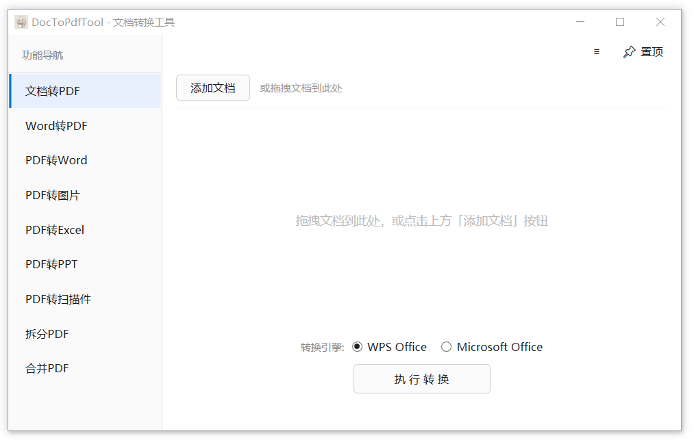

# DocToPdfTool

多功能文档格式转换工具，支持 **文档转 PDF**、**Word 转 PDF**、**PDF 转 Word**、**PDF 转 Excel**、**PDF 转 PPT**、**PDF 转图片**、**PDF 转扫描件**、**拆分 PDF** 和 **合并 PDF** 等多种转换功能。



## 功能

### 文档转 PDF
- **双引擎转换**：支持 WPS Office 和 Microsoft Office 两种转换引擎，运行时自由切换
- **格式支持**：Word（.doc/.docx）、Excel（.xls/.xlsx）、PPT（.ppt/.pptx）、文本（.txt/.rtf）、HTML（.html/.htm/.mhtml）
- **HTML 转换**：基于 Edge 浏览器 headless 模式，保留原始布局和样式
- **Excel 多工作表**：自动列宽适配、分页控制，完整转换所有工作表
- **批量转换**：支持添加/拖拽多个文档，逐文件显示转换进度
- **拖拽添加**：支持拖拽文档到列表，列表中间显示操作提示

### Word 转 PDF
- **内置引擎，无需外部依赖**：基于 Spire.Doc 本地 DLL，无需安装 Microsoft Office 或 WPS
- **批量转换**：支持同时添加多个 Word 文件，逐个转换
- **拖拽添加**：支持拖拽 Word 文件到列表

### PDF 转 Word
- **双引擎转换**：支持 Microsoft Office 和内置引擎（Spire.PDF）两种转换引擎，运行时自由切换
- **内置引擎无需 Office**：基于 Spire.PDF，无需安装 Microsoft Office，无页数限制，无水印
- **大文件分批处理**：超过 20 页的 PDF 自动分批转换后合并，内存峰值可控
- **Microsoft Office 引擎**：基于 Word COM 自动化，质量高但需要安装 Office
- **批量转换**：支持同时添加多个 PDF 文件，逐个转换
- **拖拽添加**：支持拖拽 PDF 文件到列表

### PDF 转 Excel
- **PdfPig 解析引擎**：基于 PdfPig 开源 PDF 文本提取库，不依赖 Office 组件
- **表格自动识别**：智能检测页面的表格结构，自动识别列边界和表头
- **文本换行合并**：自动合并因单元格内文本换行而被拆分的行，还原表格原始结构
- **页眉页脚过滤**：自动去除 PDF 页面的页眉页脚干扰内容
- **非表格降级**：非表格页面自动降级为文本行输出，避免数据丢失
- **多页支持**：多页 PDF 每页生成独立 Sheet，单页则输出为 Sheet1
- **Excel 原生写入**：纯 XML 方式生成 `.xlsx` 文件，无需 Excel 或任何 Office 组件
- **拖拽添加**：支持拖拽 PDF 文件到列表

### PDF 转 PPT
- **Windows 内置引擎**：基于 Windows 10/11 内置 PDF 渲染引擎（`Windows.Data.Pdf`），无需额外安装软件
- **图片转 PPT**：将 PDF 每页渲染为图片后嵌入 PPTX 幻灯片，保持原始排版
- **批量转换**：支持同时添加多个 PDF 文件，每个文件生成独立 PPTX
- **拖拽添加**：支持拖拽 PDF 文件到列表
- **零依赖**：不依赖 pdfium.dll、Ghostscript 或 Office 组件
- **兼容性好**：生成的 PPTX 在 WPS 和 Microsoft Office PowerPoint 中均可正常打开

### PDF 转图片
- **Windows 内置引擎**：基于 Windows 10/11 内置 PDF 渲染引擎（`Windows.Data.Pdf`），无需额外安装软件
- **批量转换**：支持同时添加多个 PDF 文件，每页生成一张图片
- **拖拽添加**：支持拖拽 PDF 文件到列表
- **可调参数**：支持 DPI（150/300/600）、缩放倍率（1×~5×）、输出格式（JPG/PNG）
- **零依赖**：不依赖 pdfium.dll、Ghostscript 或 Office 组件

### PDF 转扫描件
- **Windows 内置引擎**：基于 Windows 10/11 内置 PDF 渲染引擎（`Windows.Data.Pdf`），无需额外安装软件
- **图片型 PDF**：将 PDF 每页渲染为图片后嵌入新 PDF，文字不可选取编辑
- **批量转换**：支持同时添加多个 PDF 文件，每个文件生成独立扫描件 PDF
- **拖拽添加**：支持拖拽 PDF 文件到列表
- **零依赖**：纯 .NET 写入 PDF，无需 pdfium.dll、Ghostscript 或 Office 组件

### 拆分 PDF
- **按页数拆分**：每 N 页拆分为一个文件（默认每 1 页）
- **按范围拆分**：自定义页码范围，支持单页与范围混合，如 `1-5,6,7-8`
- **页数预览**：添加文件后自动显示每个 PDF 的页数，方便填写拆分参数
- **零依赖**：基于 PdfPig 的 PdfDocumentBuilder 逐页复制，保留原始文字、矢量和图片，不会栅格化
- **批量拆分**：支持同时添加多个 PDF 文件

### 合并 PDF
- **顺序合并**：列表顺序即合并顺序，支持「上移 / 下移」调整文件次序
- **页数预览**：添加文件后自动显示每个 PDF 的页数
- **防覆盖**：输出文件与已有文件重名时自动追加序号
- **零依赖**：基于 PdfPig 的 PdfDocumentBuilder 逐页复制，保留原始质量，不会栅格化

## 设置

- 点击右上角 **「≡ 设置」** 按钮打开设置窗口
- 可查看和修改**默认保存目录**（未配置时默认取系统「下载」目录）
- 设置保存在 `%APPDATA%\DocToPdfTool\config.ini`，永久生效

所有转换结果默认输出到「下载目录」，并按功能名自动创建子目录存放（目录存在则不重复创建）：

| 功能 | 输出子目录 |
|------|-----------|
| 文档转 PDF | `下载目录\文档转PDF\` |
| Word 转 PDF | `下载目录\Word转PDF\` |
| PDF 转 Word | `下载目录\PDF转Word\` |
| PDF 转 Excel | `下载目录\PDF转Excel\` |
| PDF 转 PPT | `下载目录\PDF转PPT\` |
| PDF 转图片 | `下载目录\PDF转图片\` |
| PDF 转扫描件 | `下载目录\PDF转扫描件\` |
| 拆分 PDF | `下载目录\拆分PDF\` |
| 合并 PDF | `下载目录\合并PDF\` |

## 使用

1. 点击左侧功能菜单切换到对应界面
2. 点击「添加文件」按钮或直接拖拽文件到列表
3. 按需求选择转换引擎 / 拆分方式 / 图片参数
4. 点击「执行转换」
5. 转换完成后自动打开输出目录

> 输出目录可在设置窗口中修改默认保存目录后生效，各功能的子目录会自动创建。

## 构建

### Release 构建
```bash
dotnet build -c Release
```

### 单目录发布
```bash
publish_dir.bat
```

输出在 `publish\DirPublish\`（exe + 所有依赖 DLL）

### 单文件发布
```bash
publish_single.bat
```

输出在 `publish\SingleFile\DocToPdfTool.exe`

## 技术栈

- .NET Framework 4.8 / WPF
- COM 自动化（WPS / Office 后期绑定）
- Edge Chromium headless（HTML 转 PDF）
- **Spire.PDF**（PDF 转 Word 内置引擎，本地 DLL 引用，无需 Office）
- **Spire.Doc**（Word 转 PDF 内置引擎，本地 DLL 引用，无需 Office）
- **DocumentFormat.OpenXml**（DOCX 合并 / 去水印）
- Word COM 自动化（PDF 转 Word，3 层回退创建真实 Word 实例）
- PdfPig 开源 PDF 文本提取（PDF 转 Excel、拆分 PDF（PdfDocumentBuilder）、合并 PDF）
- 纯 XML xlsx 生成（`ZipArchive` + `XElement`，零 Office 依赖）
- Win32 API 窗口守卫（抑制 Office 弹窗）
- WMI 进程监控 + WinEventHook（Word 窗口自动隐藏）
- Windows.Data.Pdf 内置 PDF 渲染引擎（PDF 转图片/PPT/扫描件，Windows 10+）
- 纯 XML pptx 生成（`ZipArchive` + `XElement`，图片嵌入幻灯片，零 Office 依赖）
- 纯 .NET PDF 写入（`BinaryWriter` + PDF 规范，零依赖嵌入 JPEG 图片）
- ini 配置（`%APPDATA%\DocToPdfTool\config.ini`，默认保存目录持久化）
- Costura.Fody（单文件打包）

## 致谢

本项目的 WPS Office 转换能力参考了 [WPSToPDF](https://github.com/lm3515/WPSToPDF)；Microsoft Office 转换部分参考了 [Pdfor](https://github.com/Vit-Lib/Pdfor)。感谢这些项目提供的灵感和参考。